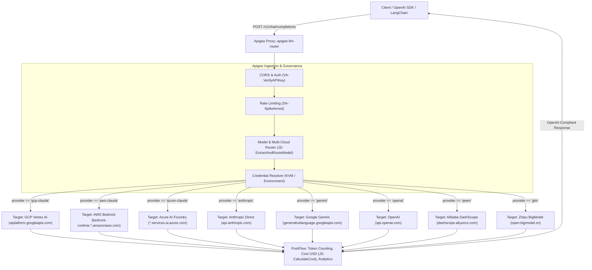

# Apigee LLM Router (`apigee-llm-router`)

An enterprise API Proxy for **Google Cloud Apigee X** that delivers **LiteLLM-compatible** capabilities:
- **Unified OpenAI Interface**: Call any LLM provider (`GCP Vertex AI Claude`, `AWS Bedrock Claude`, `Azure AI Foundry Claude`, `Anthropic Direct`, `OpenAI`, `Google Gemini`, `Alibaba Qwen`, `Zhipu GLM`) using standard OpenAI SDKs or curl against `/v1/chat/completions` and `/v1/models`.
- **Multi-Cloud Claude 4.5 / 5.5 / 4.6 Support**: Call `claude-haiku-4-5`, `claude-haiku-5-5`, and `claude-sonnet-4-6` across **GCP (Vertex AI)**, **AWS (Amazon Bedrock)**, and **Azure (Azure AI Foundry)** using provider prefixes (`gcp/claude-haiku-5-5`, `aws/claude-sonnet-4-6`, `azure/claude-haiku-4-5`) or via the `x-cloud-provider: gcp|aws|azure` header.
- **Bidirectional Schema Translation**: Transparently translates OpenAI chat payloads into GCP Vertex `:rawPredict`, AWS Bedrock `/invoke`, Azure AI Foundry `/anthropic/v1/messages`, and Google Gemini (`generateContent`) formats, and transforms responses back into standard OpenAI chat completion JSON envelopes.
- **Intelligent Routing & Aliasing**: Route via canonical model IDs or logical aliases (`fast`, `smart`, `coding`, `cheap`, `haiku-4-5`, `haiku-5-5`, `sonnet-4-6`, `qwen`, `glm`).
- **Secure Virtual Keys**: Consumers authenticate to Apigee with virtual API keys; upstream provider credentials remain hidden inside Apigee Key-Value Maps (KVM) or Google Service Account tokens.
- **Token Accounting & Real-Time Cost Tracking**: Automatically calculates prompt/completion token usage and computes USD costs via model pricing rate cards.
- **Enterprise Governance**: SpikeArrest rate limiting, CORS preflight handling, and standardized OpenAI error formatting.

---

## Architecture



---

## Multi-Cloud Claude Models (GCP, AWS, Azure)

| Model | GCP (Vertex AI) | AWS (Amazon Bedrock) | Azure (AI Foundry) | Input / Output Rate (per 1M) |
| :--- | :--- | :--- | :--- | :--- |
| **`claude-haiku-4-5`** | `gcp/claude-haiku-4-5` (`claude-haiku-4-5@20251001`) | `aws/claude-haiku-4-5` (`us.anthropic.claude-haiku-4-5-20251001-v1:0`) | `azure/claude-haiku-4-5` (`claude-haiku-4-5`) | \$1.00 / \$5.00 |
| **`claude-haiku-5-5`** | `gcp/claude-haiku-5-5` (`claude-haiku-5-5`) | `aws/claude-haiku-5-5` (`us.anthropic.claude-haiku-5-5-v1:0`) | `azure/claude-haiku-5-5` (`claude-haiku-5-5`) | \$0.10 / \$0.50 |
| **`claude-sonnet-4-6`** | `gcp/claude-sonnet-4-6` (`claude-sonnet-4-6`) | `aws/claude-sonnet-4-6` (`us.anthropic.claude-sonnet-4-6-v1:0`) | `azure/claude-sonnet-4-6` (`claude-sonnet-4-6`) | \$3.00 / \$15.00 |

> **Selection Mechanism**:
> 1. **Model Prefix (LiteLLM style)**: Specify `"model": "gcp/claude-haiku-5-5"`, `"model": "aws/claude-sonnet-4-6"`, or `"model": "azure/claude-haiku-4-5"`.
> 2. **Header Override**: Specify unprefixed `"model": "claude-sonnet-4-6"` with request header `x-cloud-provider: aws`, `x-cloud-provider: azure`, or `x-cloud-provider: gcp` (defaults to `gcp`).

---

## Other Supported Providers & Models

| Provider | Supported Models | Native Protocol | Upstream Base URL |
| :--- | :--- | :--- | :--- |
| **OpenAI** | `gpt-4o`, `gpt-4o-mini`, `o1`, `o3-mini`, `gpt-3.5-turbo` | OpenAI Chat | `https://api.openai.com/v1` |
| **Anthropic Direct** | `claude-3-5-sonnet-20241022`, `claude-3-5-haiku-20241022`, `claude-3-opus-20240229` | Messages API | `https://api.anthropic.com/v1` |
| **Google Gemini** | `gemini-2.0-flash`, `gemini-1.5-pro`, `gemini-1.5-flash` | generateContent | `https://generativelanguage.googleapis.com/v1beta` |
| **Alibaba Qwen** | `qwen-plus`, `qwen-max`, `qwen-turbo`, `qwen-2.5-72b-instruct`, `qwen-2.5-coder-32b-instruct` | OpenAI-Compatible | `https://dashscope.aliyuncs.com/compatible-mode/v1` |
| **Zhipu GLM** | `glm-4-plus`, `glm-4-air`, `glm-4-flash` | OpenAI-Compatible | `https://open.bigmodel.cn/api/paas/v4` |

### Logical Model Aliases
- `haiku-4-5` &rarr; Routes to `claude-haiku-4-5`
- `haiku-5-5` &rarr; Routes to `claude-haiku-5-5`
- `sonnet-4-6` &rarr; Routes to `claude-sonnet-4-6`
- `fast` &rarr; Routes to `gemini-2.0-flash`
- `smart` &rarr; Routes to `gpt-4o`
- `coding` &rarr; Routes to `qwen-2.5-coder-32b-instruct`
- `cheap` &rarr; Routes to `glm-4-flash`
- `qwen` &rarr; Routes to `qwen-plus`
- `glm` &rarr; Routes to `glm-4-plus`
- `default` &rarr; Routes to `gemini-2.0-flash`

---

## Prerequisites

1. **Google Cloud SDK (`gcloud`)**: Authenticated (`gcloud auth login`) with an account that has `roles/apigee.admin` (or equivalent permissions to manage KVMs, API Proxies, API Products, Developers, and Apps).
2. **CLI Tools**: `bash`, `curl`, `zip`, `python3` (and `node` >= 18 for local unit tests).
3. **Apigee X Instance**: An active Apigee X organization, environment (e.g., `prod` or `eval`), and environment group hostname.
4. **LLM Provider Access** (configure one or more):
   - **GCP Vertex AI (`gcp-claude`)**: Uses Apigee's native `<GoogleAccessToken>` authentication—no static API key required. Ensure the **Apigee Runtime Service Account** you deploy with has `roles/aiplatform.user` in your GCP project and that Anthropic Claude models are enabled in Vertex AI Model Garden.
   - **AWS Bedrock (`aws-claude`)**: AWS Bedrock Runtime bearer token / API key and region (e.g., `us-east-1`).
   - **Azure AI Foundry (`azure-claude`)**: Azure AI Foundry resource name and API key.
   - **Google Gemini / OpenAI / Anthropic Direct / Alibaba Qwen / Zhipu GLM**: Respective upstream provider API keys.

---

## Deployment & Testing Guide

### Option A: One-Click End-to-End Deployment & Testing (`deploy_and_test.sh`)

The easiest way to provision, deploy, and test the entire router is using [`deploy_and_test.sh`](./deploy_and_test.sh).

#### Step 1: Configure Variables
Open [`deploy_and_test.sh`](./deploy_and_test.sh) and update the configuration block at the top of the file (lines 14–48):

```bash
# --- 1. Google Cloud & Apigee Configuration ---
PROJECT_ID="your-gcp-project-id"                      # GCP Project ID
APIGEE_ORG="your-apigee-org"                          # Apigee Organization name (usually same as PROJECT_ID)
APIGEE_ENV="prod"                                     # Target Apigee Environment (e.g., prod, eval, dev)
APIGEE_HOST="api.yourdomain.com"                      # Apigee Environment Group hostname

# Optional: Service Account for Apigee proxy runtime (needed for GCP Vertex AI GoogleAccessToken)
# Requires roles/aiplatform.user in your GCP project.
RUNTIME_SA="apigee-vertex-sa@${PROJECT_ID}.iam.gserviceaccount.com"

# --- 2. Developer & App Provisioning ---
DEVELOPER_EMAIL="developer@example.com"
PRODUCT_NAME="llm-router-product"
APP_NAME="llm-router-consumer-app"

# --- 3. Upstream Provider Credentials (stored in Apigee KVM 'llm-credentials') ---
GCP_PROJECT_ID="${PROJECT_ID}"
GCP_REGION="global"
AWS_REGION="us-east-1"
AWS_BEARER_TOKEN_BEDROCK=""                           # Optional: AWS Bedrock token
AZURE_RESOURCE_NAME="your-azure-foundry-resource"     # Optional: Azure AI Foundry resource name
AZURE_FOUNDRY_API_KEY=""                              # Optional: Azure AI Foundry API key
GEMINI_API_KEY=""                                     # Optional: Google AI Studio API key
OPENAI_API_KEY=""                                     # Optional: OpenAI API key
ANTHROPIC_API_KEY=""                                  # Optional: Anthropic Direct API key
QWEN_API_KEY=""                                       # Optional: Alibaba DashScope API key
GLM_API_KEY=""                                        # Optional: Zhipu BigModel API key
```

#### Step 2: Run the Script
```bash
chmod +x deploy_and_test.sh
./deploy_and_test.sh
```

**What `deploy_and_test.sh` executes automatically:**
1. **Validates & Packages**: Runs [`scripts/validate_bundle.py`](./scripts/validate_bundle.py) to verify all XML files, policies, and route rules, then packages `dist/apigee-llm-router.zip`.
2. **Provisions Encrypted KVM**: Creates the environment-scoped encrypted KVM `llm-credentials` and populates any configured upstream provider keys/regions.
3. **Imports & Deploys Proxy**: Uploads a new revision of `apigee-llm-router`, deploys it to `$APIGEE_ENV` (attaching `$RUNTIME_SA` if configured), and polls until the revision reports `READY`.
4. **Creates API Product, Developer & App**: Provisions `llm-router-product`, registers the developer and app, approves the credential onto the product, and extracts the **Apigee Consumer API Key (`APIGEE_API_KEY`)**.
5. **Runs Live Verification Tests**: Executes live requests against `/v1/health`, `/v1/models`, and `/v1/chat/completions` (`gcp/claude-haiku-4-5`, `gcp/claude-haiku-5-5`, `gcp/claude-sonnet-4-6`, and any other configured providers) and prints ready-to-use `curl` commands.

---

### Option B: Step-by-Step Modular Scripts

If you prefer to run each lifecycle step individually (e.g., in CI/CD pipelines):

```bash
# 1. Run local unit tests (22 assertions across all JS policies)
npm test

# 2. Validate proxy XML bundle & policy attachments
npm run validate

# 3. Package apiproxy/ into dist/apigee-llm-router.zip
npm run package

# 4. Provision the Apigee KVM ('llm-credentials')
export APIGEE_ORG="your-apigee-org"
export APIGEE_ENV="prod"
npm run provision-kvm

# 5. Import & deploy the proxy bundle to Apigee X
npm run deploy -- --org "$APIGEE_ORG" --env "$APIGEE_ENV" --sa "apigee-vertex-sa@${APIGEE_ORG}.iam.gserviceaccount.com"

# 6. Provision API Product, Developer, and Consumer App (outputs APIGEE_API_KEY)
npm run provision-app

# 7. Run live smoke tests
export APIGEE_HOST="api.yourdomain.com"
export APIGEE_API_KEY="your-apigee-consumer-key"
npm run test:live
```

---

## Apigee KVM (`llm-credentials`) Reference

The proxy reads upstream credentials and regional parameters from the encrypted environment KVM named `llm-credentials` via [`KVM-GetProviderCredentials.xml`](./apiproxy/policies/KVM-GetProviderCredentials.xml):

| KVM Key Name | Used By Target | Default / Fallback | Description |
| :--- | :--- | :--- | :--- |
| `gcp_project_id` | `target-gcp-claude` | `organization.name` | GCP Project ID for Vertex AI `:rawPredict` |
| `gcp_region` | `target-gcp-claude` | `global` | Vertex AI region (`global`, `us-east5`, `europe-west1`, etc.) |
| `aws_bedrock_api_key` | `target-aws-claude` | — | AWS Bedrock Runtime bearer token |
| `aws_region` | `target-aws-claude` | `us-east-1` | AWS Bedrock region |
| `azure_foundry_api_key` | `target-azure-claude` | — | Azure AI Foundry API key (`x-api-key`) |
| `azure_resource_name` | `target-azure-claude` | `azure-ai-foundry` | Azure AI Foundry resource subdomain (`<name>.services.ai.azure.com`) |
| `openai_api_key` | `target-openai` | — | OpenAI API key |
| `anthropic_api_key` | `target-anthropic` | — | Anthropic Direct API key |
| `gemini_api_key` | `target-gemini` | — | Google AI Studio Gemini API key |
| `qwen_api_key` | `target-qwen` | — | Alibaba Cloud DashScope API key |
| `glm_api_key` | `target-glm` | — | Zhipu AI BigModel API key |

> **Tip**: During testing, you can also pass `x-upstream-api-key: <PROVIDER_KEY>` in the request header to test an upstream provider on the fly before populating its KVM entry.

---

## Usage Examples

### 1. Call `claude-haiku-5-5` on GCP Vertex AI
```bash
curl -X POST "https://YOUR-APIGEE-HOST/v1/chat/completions" \
  -H "Authorization: Bearer <APIGEE_API_KEY>" \
  -H "Content-Type: application/json" \
  -d '{
    "model": "gcp/claude-haiku-5-5",
    "messages": [
      {"role": "user", "content": "Explain API gateways in one sentence."}
    ]
  }'
```

### 2. Call `claude-sonnet-4-6` on AWS Bedrock
```bash
curl -X POST "https://YOUR-APIGEE-HOST/v1/chat/completions" \
  -H "Authorization: Bearer <APIGEE_API_KEY>" \
  -H "Content-Type: application/json" \
  -d '{
    "model": "aws/claude-sonnet-4-6",
    "messages": [
      {"role": "user", "content": "Design a resilient multi-cloud architecture."}
    ]
  }'
```

### 3. Call `claude-haiku-4-5` on Azure AI Foundry
```bash
curl -X POST "https://YOUR-APIGEE-HOST/v1/chat/completions" \
  -H "Authorization: Bearer <APIGEE_API_KEY>" \
  -H "Content-Type: application/json" \
  -d '{
    "model": "azure/claude-haiku-4-5",
    "messages": [
      {"role": "user", "content": "Summarize zero-trust networking."}
    ]
  }'
```

---

## Response Headers, Cost Tracking & Telemetry

Every chat completion through the gateway returns telemetry headers:
- `x-llm-provider`: Target provider (`gcp-claude`, `aws-claude`, `azure-claude`, `anthropic`, `openai`, `gemini`, `qwen`, `glm`)
- `x-llm-cloud-provider`: Cloud hyperscaler (`gcp`, `aws`, `azure`, `openai`, `alibaba`, `zhipuai`)
- `x-llm-model`: Resolved upstream model ID
- `x-llm-prompt-tokens`: Prompt token count
- `x-llm-completion-tokens`: Completion token count
- `x-llm-total-tokens`: Total token count
- `x-llm-cost-usd`: Precise cost in USD calculated from rate cards

> **No Apigee Monetization Add-On Required**: To ensure the proxy works out-of-the-box across all Apigee X organizations (including evaluation and standard orgs without the Monetization add-on enabled), it does **not** depend on `<MonetizationLimitsCheck>`. Instead, token usage and USD cost are computed in [`CalculateCost.js`](./apiproxy/resources/jsc/CalculateCost.js) and exported to Apigee Analytics custom metrics/dimensions via [`DC-ModelAnalytics.xml`](./apiproxy/policies/DC-ModelAnalytics.xml) (`DataCapture`).

